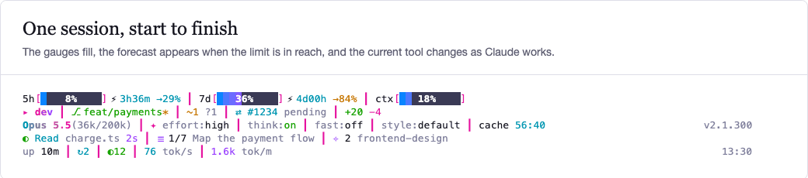
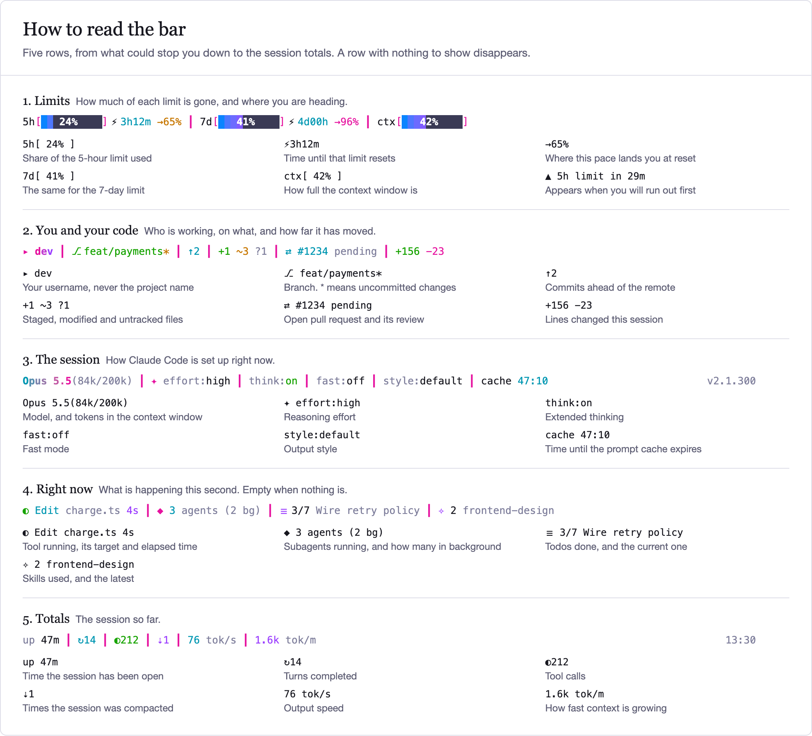
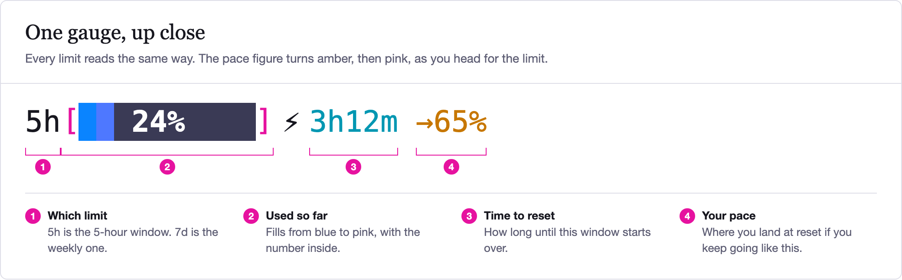
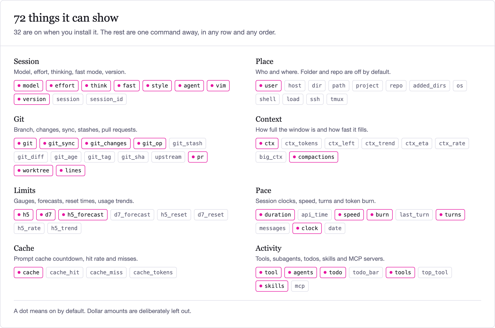
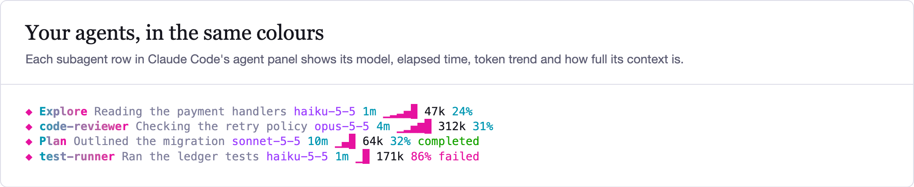
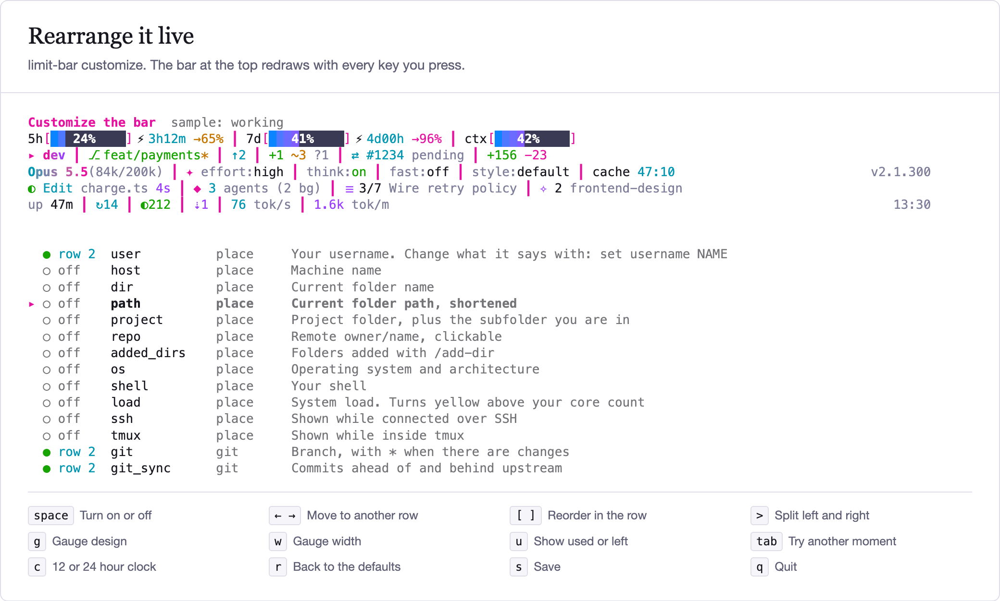
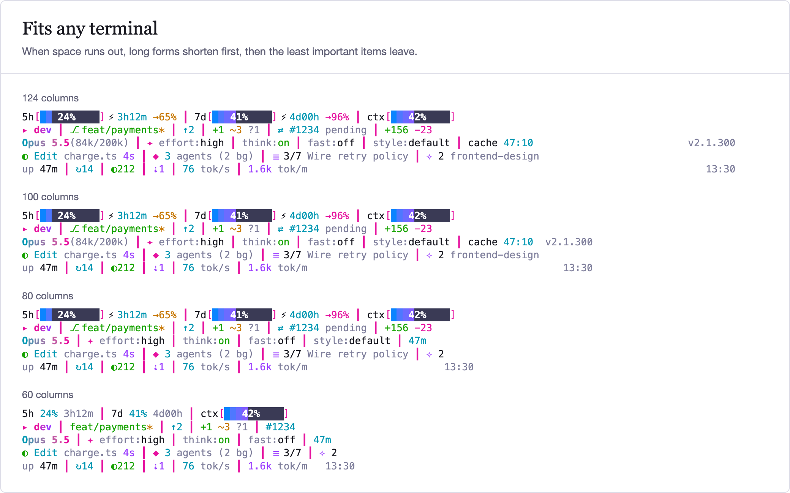
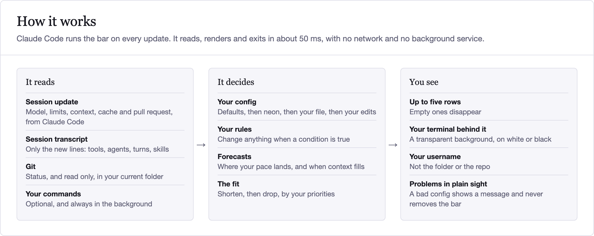

# claude-code-limit-bar

A neon status line for Claude Code. It shows how close you are to your limits and where
your pace will land you, what Claude is doing this second, and how far the work has moved.



```sh
npx github:Abbishekk-DGS/claude-code-limit-bar install
```

Start a new Claude Code session and it's there. It needs Node 18 or newer, has no
dependencies, and never touches the network. Your existing status line is saved, and
`limit-bar uninstall` puts it back.

## Why use it

| | |
|---|---|
| **See trouble coming** | Each gauge shows where your pace lands at reset, and a warning appears if you will run out first |
| **Better for screenshots** | It shows your username, not the folder, the repo or its own name, unless you turn those on. Branch and file names still appear |
| **Yours to rearrange** | Move anything with a live editor, a one-line command or a config file |
| **Reads anywhere** | The background is transparent, and the colours are picked to read on white and on black |

## How to read it

<picture>
  <source media="(prefers-color-scheme: dark)" srcset="assets/anatomy-dark.png">
  
</picture>

<picture>
  <source media="(prefers-color-scheme: dark)" srcset="assets/gauge-dark.png">
  
</picture>

## Everything it can show

<picture>
  <source media="(prefers-color-scheme: dark)" srcset="assets/modules-dark.png">
  
</picture>

<details>
<summary>What each one shows</summary>

<!-- modules:start -->
| Name | On | What it shows |
|---|---|---|
| **Session** | | |
| `model` | ● | Model name, with tokens used out of the context window |
| `effort` | ● | Reasoning effort level |
| `think` | ● | Extended thinking on or off |
| `fast` | ● | Fast mode on or off |
| `style` | ● | Output style |
| `agent` | ● | Agent the session runs as (--agent) |
| `vim` | ● | Vim mode |
| `version` | ● | Claude Code version |
| `session` |  | Session name. It can mention a project, so it is off by default |
| `session_id` |  | First characters of the session id |
| **Place** | | |
| `user` | ● | Your username. Change what it says with: set username NAME |
| `host` |  | Machine name |
| `dir` |  | Current folder name |
| `path` |  | Current folder path, shortened |
| `project` |  | Project folder, plus the subfolder you are in |
| `repo` |  | Remote owner/name, clickable |
| `added_dirs` |  | Folders added with /add-dir |
| `os` |  | Operating system and architecture |
| `shell` |  | Your shell |
| `load` |  | System load. Turns yellow above your core count |
| `ssh` |  | Shown while connected over SSH |
| `tmux` |  | Shown while inside tmux |
| **Git** | | |
| `git` | ● | Branch, with * when there are changes |
| `git_sync` | ● | Commits ahead of and behind upstream |
| `git_changes` | ● | Staged, modified, untracked and conflicted files |
| `git_op` | ● | Merge, rebase, cherry-pick, revert or bisect in progress |
| `git_stash` |  | Number of stashes |
| `git_diff` |  | Lines added and removed in the working tree |
| `git_age` |  | Time since the last commit |
| `git_tag` |  | Tag on the current commit |
| `git_sha` |  | Short commit id |
| `upstream` |  | Upstream branch |
| `pr` | ● | Open pull request and its review state, clickable |
| `worktree` | ● | Linked worktree name |
| `lines` | ● | Lines added and removed this session |
| **Context** | | |
| `ctx` | ● | Context window gauge |
| `ctx_tokens` |  | Tokens used out of the window |
| `ctx_left` |  | Tokens left in the window |
| `ctx_trend` |  | Sparkline of context use |
| `ctx_eta` |  | Estimated time until the window is full |
| `ctx_rate` |  | How fast context is filling, percent per minute |
| `big_ctx` |  | Warns when the session has passed 200k tokens |
| `compactions` | ● | Times this session has been compacted |
| **Limits** | | |
| `h5` | ● | 5-hour limit gauge, time to reset, and where you are heading |
| `d7` | ● | 7-day limit gauge, time to reset, and where you are heading |
| `h5_forecast` | ● | Warns when you will hit the 5-hour limit before it resets |
| `d7_forecast` |  | Warns when you will hit the 7-day limit before it resets |
| `h5_reset` |  | Clock time the 5-hour limit resets |
| `d7_reset` |  | Day and time the 7-day limit resets |
| `h5_rate` |  | How fast the 5-hour limit is being used, percent per hour |
| `h5_trend` |  | Sparkline of 5-hour limit use |
| **Pace** | | |
| `duration` | ● | How long this session has been open |
| `api_time` |  | Time spent waiting on the model |
| `speed` | ● | Output speed, tokens per second of model time |
| `burn` | ● | Tokens added to context per minute |
| `last_turn` |  | How long the last turn took |
| `turns` | ● | Turns completed this session |
| `messages` |  | Messages in the conversation |
| `clock` | ● | Current time. Switch with: set clock 12h |
| `date` |  | Today's date |
| **Cache** | | |
| `cache` | ● | Prompt cache countdown, or COLD once it has expired |
| `cache_hit` |  | Prompt cache hit rate |
| `cache_miss` |  | Cache misses, and why the last one happened |
| `cache_tokens` |  | Tokens written to the cache, and tokens rewritten after misses |
| **Activity** | | |
| `tool` | ● | Tool running right now, with its target and elapsed time |
| `agents` | ● | Subagents running in the foreground and background |
| `todo` | ● | Todo progress and the current item |
| `todo_bar` |  | Todo progress as a gauge |
| `tools` | ● | Tool calls this session |
| `top_tool` |  | Most used tool this session |
| `skills` | ● | Skills used this session, and the latest one |
| `mcp` |  | MCP servers called this session |
<!-- modules:end -->

</details>

Subagents get the same treatment in Claude Code's agent panel:

<picture>
  <source media="(prefers-color-scheme: dark)" srcset="assets/agents-dark.png">
  
</picture>

## Make it yours

**The live editor** shows the bar updating as you go:

```sh
limit-bar customize
```

<picture>
  <source media="(prefers-color-scheme: dark)" srcset="assets/editor-dark.png">
  
</picture>

**The same from the command line:**

```sh
limit-bar show git_stash --row 2 --after git_changes
limit-bar hide version
limit-bar move clock --row 1
limit-bar set username neo
limit-bar set gauge_width 14
limit-bar set bar thin            # meter, thin, ticks or dots
limit-bar color pink "#ff00aa"
limit-bar reset                   # back to the defaults
```

These save to `~/.config/limit-bar/custom.toml`, so they never touch your own config.

**Or write it by hand.** Your own config lives in `~/.config/limit-bar/config.toml`.
`limit-bar init` writes a commented starter. Each step below is a complete, working change.

**Choose your rows.** A `">"` pushes what follows to the right.

```toml
[layout]
rows = [
  ["h5", "d7", "ctx"],
  ["user", "git", "git_changes", ">", "clock"],
]
```

**Recolour anything**

```toml
[palette]
cyan = "#7fe3dd"
pink = "#ff7a1a"
```

**Rewrite a built-in module.** They are all ordinary config, so
[`src/defaults.toml`](src/defaults.toml) doubles as a set of examples.

```toml
[module.ctx]
format = "context {ctx.pct | bar:20:dots} {ctx.tokens | tokens}"
style = "= ctx.pct > 80 ? 'hot bold' : 'muted'"
```

**Lay out a row in full.** Each `[[line]]` is a row with left, center and right sides.
Any `[[line]]` replaces `[layout]`.

```toml
[[line]]
left = ["model", "user", "git"]
right = ["ctx", "h5"]

[[line]]
if = "todo.total"
left = "{todo.done}/{todo.total} <muted>{todo.current}</>"
```

**Show anything a command can print.** Commands run in a background process, so a slow
one can't hold up the bar.

```toml
[source.kube]
command = "kubectl config current-context"
every = "30s"

[module.kube]
if = "source.kube.value"
format = "k8s {source.kube.value}"
style = "= contains(source.kube.value, 'prod') ? 'hot bold' : 'muted'"
```

**Let the bar react to what is happening.** A rule can override any part of the config.

```toml
[[when]]
name = "show the forecasts when a limit is close"
if = "ctx.pct >= 85 || limit.h5.pct >= 85"
[when.layout]
rows = [["h5", "d7", "ctx"], ["h5_forecast", "d7_forecast", "ctx_eta", "burn"]]
```

Rules can read the branch, project, model, terminal width, time of day, or the output of
any source. There are ready-to-copy configs in [`examples/`](examples): protecting `main`,
CI status, cloud context, and plain ASCII over SSH.

The [configuration reference](docs/CONFIG.md) covers every setting, all 19 filters, the
expression language and each variable. A test keeps it in step with the code.

## Built for small terminals

When a line doesn't fit, limit-bar gives things up gradually: modules switch to their short
format one at a time, then the least important ones leave, and text is only cut as a last
resort. You set the order with `priority`, and a rule can switch to a different layout at
any width.

<picture>
  <source media="(prefers-color-scheme: dark)" srcset="assets/responsive-dark.png">
  
</picture>

## How it works

<picture>
  <source media="(prefers-color-scheme: dark)" srcset="assets/flow-dark.png">
  
</picture>

## It tells you what it is doing

```sh
limit-bar validate    # mistakes, with line numbers and "did you mean"
limit-bar explain     # which files and rules applied, what is shown or hidden, and why
limit-bar fields      # every variable and its live value
limit-bar doctor      # checks the whole setup
```

```
config.toml:3  error  module.ctx.formt: unknown key "formt", did you mean "format"?
config.toml:5  warning  module.git.if: unknown variable "git.brnch", did you mean "git.branch"?
config.toml:7  error  line[0].left: unknown module "modle", did you mean "model"?
```

A broken config never takes the bar away. It keeps rendering what it can and shows the
problem on its own row.

## Forecasts

Beyond the numbers Claude Code provides, limit-bar works out:

- **Rate limit pace.** `limit.h5.projected` is where you will be at reset if your pace
  holds, and `limit.h5.hit_in` is how long until you hit 100%.
- **Time until context is full.** `ctx.eta` comes from your recent growth, and restarts
  after `/compact` instead of treating the drop as negative use.
- **History.** `history.ctx`, which `spark` turns into a sparkline.

The bar shows no dollar amounts. `cost`, `cost_rate` and `spend` modules exist if you add
them by hand, but they are not in the default rows or the editor.

These are straight-line estimates. Real usage comes in bursts, so treat them as a guide.
Projections stay off for the first 15% of a window, when there is too little to go on.

## Safety

A status line runs constantly, so it should be boring to trust.

- **No network access.** limit-bar makes no network calls and has no updater, telemetry or
  daemon. The only outside programs it starts are `git` and the commands you configure.
- **Projects can't run code.** A repo's `.limit-bar.toml` is ignored until you run
  `limit-bar trust`, which lists the commands it would run. Editing the file revokes approval.
- **Hostile text stays text.** Terminal control codes are stripped from branch names,
  session names and command output. Link addresses are limited to `http`, `https` and `file`.
- **Git stays read-only.** It runs with `core.fsmonitor`, external diff drivers and
  signature checks off, so a cloned repo's config can't use it to start a program.
- **No eval.** Expressions go through a small parser that can only read variables.

## Speed

About 50 ms per update as Claude Code runs it, nearly all of that Node starting up, and
under 1 ms for the render itself. Measured on an Apple Silicon MacBook with 8 GB of RAM;
run `limit-bar bench` for your own numbers. Claude Code waits for 300 ms of quiet between
updates, so this is well inside the budget. Git, history and transcript reads only happen
if your layout uses them, and the transcript is read incrementally, so long sessions cost
no more than short ones.

## Commands

| Command | What it does |
|---|---|
| `limit-bar install [--refresh SECONDS] [--no-agent-rows] [--dry-run]` | Set up Claude Code. Default refresh is 5 seconds |
| `limit-bar uninstall [--purge]` | Restore your previous status line |
| `limit-bar customize` | Live editor with a preview |
| `limit-bar modules [FILTER]` / `rows` | What you can show, and the current layout |
| `limit-bar show` / `hide` / `move NAME` | Change the rows |
| `limit-bar set [KEY VALUE]` / `color [NAME #HEX]` | Change settings and colours |
| `limit-bar reset` | Back to the defaults |
| `limit-bar preview [--state fresh\|working\|danger] [--cols N]` | Try it on sample data |
| `limit-bar init` | Write a commented starter config |
| `limit-bar validate` / `explain` / `fields` / `doctor` / `bench` | Inspect and debug |
| `limit-bar trust` / `untrust` | Approve or revoke this project's config |

## Limits

- It needs Node. A native binary would start faster, at the cost of a build per platform
  and an install that is harder to read.
- Windows is untested. CI runs on Linux and macOS.
- `tool.*`, `todo.*`, `agents.*` and `stats.*` read the session transcript, whose format
  is not a public contract. If it changes, they go empty rather than break.
- `todo.*` only sees the `TodoWrite` tool, so it stays empty in sessions that do not use it.
- `speed.output` reads low after subagents have run, because Claude Code's model time
  includes theirs while the session's token count does not.
- Status lines hide while Claude Code shows permission prompts and some menus. That comes
  from Claude Code itself.

## Credits

The design was informed by studying
[claude-code-usage-bar](https://github.com/leeguooooo/claude-code-usage-bar),
[ccstatusline](https://github.com/sirmalloc/ccstatusline) and
[claude-powerline](https://github.com/Owloops/claude-powerline), all MIT licensed and all
worth a look. limit-bar is a separate codebase and contains none of their code.

## License

Not affiliated with Anthropic.


[MIT](LICENSE)
