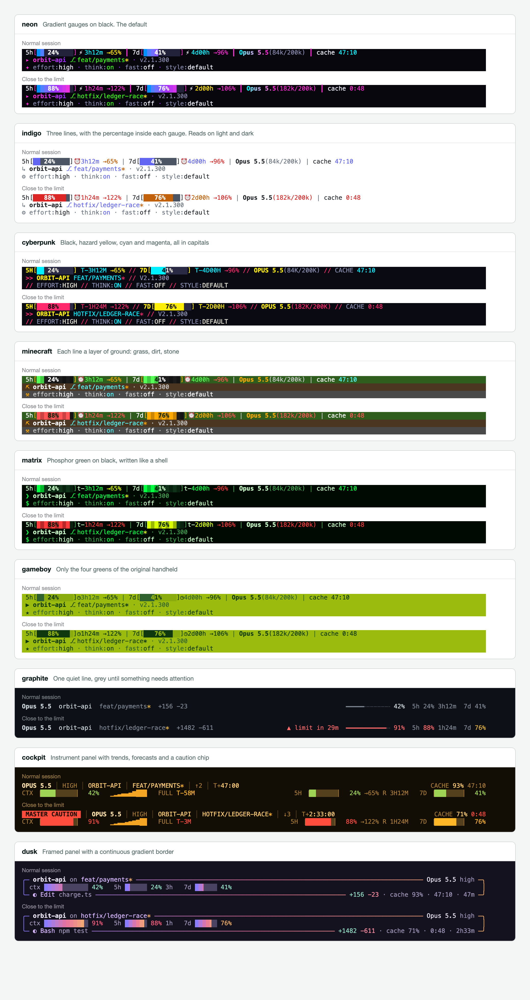
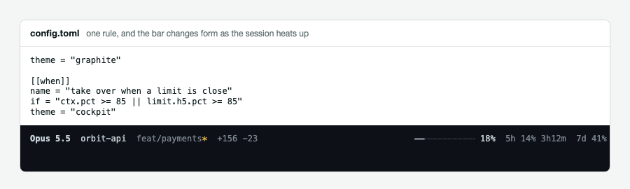

# claude-code-limit-bar

A status line for Claude Code that you build entirely from a dotfile. Layouts, colours,
gauges, every built-in module and the rules that change them all live in plain TOML.



```sh
npx github:Abbishekk-DGS/claude-code-limit-bar install
```

That also gives you the short command `limit-bar`, used below. Your next session uses it. Needs Node 18 or newer and has no dependencies. Your existing
status line is saved, and `limit-bar uninstall` puts it back.

## Themes

Each theme is one readable TOML file, and they differ in layout as well as colour.

| Theme | What it is |
|---|---|
| `indigo` | Three lines: gauges with the percentage inside, then place, then session settings |
| `cyberpunk` | Same layout in black, yellow, cyan and magenta, all in capitals |
| `minecraft` | Same layout with each line a layer of ground: grass, dirt, stone |
| `neon` | Same layout on black, with gradient gauges running blue to pink. The default |
| `matrix` | Same layout in green on black |
| `gameboy` | Same layout in the four greens of the original handheld |
| `graphite` | One quiet line, grey until something needs your attention |
| `cockpit` | Two-line instrument panel with trends, forecasts and a caution chip |
| `dusk` | Framed panel with one gradient running through the whole border |

```sh
limit-bar themes        # see them, live
limit-bar use cockpit   # switch, keeping the comments in your config
```

`indigo` stays readable on light and dark terminals, and `cyberpunk`, `minecraft`,
`neon`, `matrix` and `gameboy` paint their own background so they look the same on
both. The other three are designed for dark terminals. None need a special font. Set
`charset = "nerd"` if yours has Nerd Font glyphs, or `ascii` for old terminals. Any
theme can be copied and changed with `limit-bar theme new NAME --from cockpit`.

## Make it yours

Config lives in `~/.config/limit-bar/config.toml`. `limit-bar init` writes a commented starter.
Each step below is a complete, working change.

**Recolour anything**

```toml
[palette]
accent = "#7fe3dd"
hot = "#ff7a1a"
```

**Rewrite a built-in module.** They are all ordinary config, so
[`src/defaults.toml`](src/defaults.toml) doubles as a set of examples.

```toml
[module.ctx]
format = "context {ctx.pct | bar:20:dots} {ctx.tokens | tokens}"
style = "= ctx.pct > 80 ? 'hot bold' : 'muted'"
```

**Lay it out however you like.** Each `[[line]]` is a row, with left, center and right sides.

```toml
[[line]]
left = ["model", "dir", "git"]
right = ["ctx", "h5"]

[[line]]
if = "todo.total"
left = "{todo.done}/{todo.total} <muted>{todo.current}</>"
```

**Add a row without touching the layout.** `[[append_line]]` sits under any theme, so it
stays when you switch. This one shows who and where you are.

```toml
[[append_line]]
left = ["user", "path", "session"]
right = ["ctx_tokens", "cache", "duration", "version", "clock"]
```

**Show anything a command can print.** Commands run in a background process, so a slow
one can't hold up the bar.

```toml
[source.kube]
command = "kubectl config current-context"
every = "30s"

[module.kube]
if = "source.kube.value"
format = "k8s {source.kube.value}"
style = "= contains(source.kube.value, 'prod') ? 'hot bold' : 'muted'"
```

**Let the whole bar react to what is happening.** A rule can override any part of the
config, up to and including the theme.

```toml
[[when]]
name = "take over when a limit is close"
if = "ctx.pct >= 85 || limit.h5.pct >= 85"
theme = "cockpit"
```



Rules can read the branch, project, model, terminal width, time of day, or the output of
any source. There are ready-to-copy configs in [`examples/`](examples): protecting `main`,
CI status, cloud context, and plain ASCII over SSH.

The [configuration reference](docs/CONFIG.md) covers every setting, all 19 filters, the
expression language and each variable. A test keeps it in step with the code.

## Built for small terminals

When a line doesn't fit, limit-bar gives things up gradually: modules switch to their short
format one at a time, then the least important ones leave, and text is only cut as a last
resort. You set the order with `priority`, and a rule can switch to a different layout at
any width. `dusk` does this, folding its frame into a single line below 72 columns.


## It tells you what it is doing

```sh
limit-bar validate    # mistakes, with line numbers and "did you mean"
limit-bar explain     # which files and rules applied, what is shown or hidden, and why
limit-bar fields      # every variable and its live value
limit-bar doctor      # checks the whole setup
```

```
config.toml:3  error  module.ctx.formt: unknown key "formt", did you mean "format"?
config.toml:5  warning  module.git.if: unknown variable "git.brnch", did you mean "git.branch"?
config.toml:7  error  line[0].left: unknown module "modle", did you mean "model"?
```

A broken config never takes the bar away. It keeps rendering what it can and shows the
problem on its own row.

## Forecasts

Beyond the numbers Claude Code provides, limit-bar works out:

- **Rate limit pace.** `limit.h5.projected` is where you will be at reset if your pace
  holds, and `limit.h5.hit_in` is how long until you hit 100%.
- **Time until context is full.** `ctx.eta` comes from your recent growth, and restarts
  after `/compact` instead of treating the drop as negative use.
- **History.** `history.ctx`, which `spark` turns into a sparkline. Cost is available as
  `cost.usd` and `cost.per_hour`, but neither theme shows it unless you add the `cost` module.

These are straight-line estimates. Real usage comes in bursts, so treat them as a guide.
Projections stay off for the first 15% of a window, when there is too little to go on.

## Safety

A status line runs constantly, so it should be boring to trust.

- **No network access.** limit-bar makes no network calls and has no updater, telemetry or
  daemon. The only outside programs it starts are `git` and the commands you configure.
- **Projects can't run code.** A repo's `.limit-bar.toml` is ignored until you run
  `limit-bar trust`, which lists the commands it would run. Editing the file revokes approval.
- **Themes can't run code.** The loader removes `[source]` from them, so a theme from a
  stranger is safe to try.
- **Hostile text stays text.** Terminal control codes are stripped from branch names,
  session names and command output. Link addresses are limited to `http`, `https` and `file`.
- **Git stays read-only.** It runs with `core.fsmonitor` forced off, so a cloned repo's
  config can't use it to start a program.
- **No eval.** Expressions go through a small parser that can only read variables.

## Speed

About 50 ms per update as Claude Code runs it, nearly all of that Node starting up, and
under 1 ms for the render itself. Measured on an Apple Silicon MacBook with 8 GB of RAM;
run `limit-bar bench` for your own numbers. Claude Code waits for 300 ms of quiet between
updates, so this is well inside the budget. Git, history and transcript reads only happen
if your layout uses them.

## Commands

| Command | What it does |
|---|---|
| `limit-bar install [--theme NAME] [--refresh SECONDS] [--dry-run]` | Set up Claude Code. Default refresh is 5 seconds |
| `limit-bar uninstall [--purge]` | Restore your previous status line |
| `limit-bar themes` / `use NAME` | List or switch themes |
| `limit-bar preview [NAME\|all] [--state fresh\|working\|danger] [--cols N]` | Try a theme on sample data |
| `limit-bar theme new NAME [--from BASE]` | Copy a theme into your config to edit |
| `limit-bar init` | Write a commented starter config |
| `limit-bar validate` / `explain` / `fields` / `doctor` / `bench` | Inspect and debug |
| `limit-bar trust` / `untrust` | Approve or revoke this project's config |

## Limits

- It needs Node. A native binary would start faster, at the cost of a build per platform
  and an install that is harder to read.
- Windows is untested. CI runs on Linux and macOS.
- `tool.*` and `todo.*` read the session transcript, whose format is not a public contract.
  If it changes, they go empty rather than break.
- Status lines hide while Claude Code shows permission prompts and some menus. That comes
  from Claude Code itself.

## Credits

The design was informed by studying
[claude-code-usage-bar](https://github.com/leeguooooo/claude-code-usage-bar),
[ccstatusline](https://github.com/sirmalloc/ccstatusline) and
[claude-powerline](https://github.com/Owloops/claude-powerline), all MIT licensed and all
worth a look. limit-bar is a separate codebase and contains none of their code.

## License

[MIT](LICENSE)
