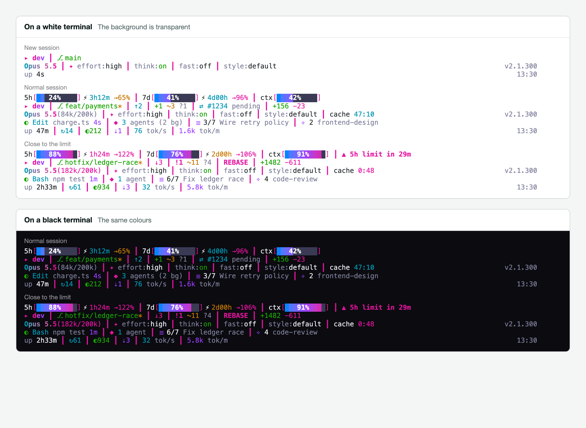
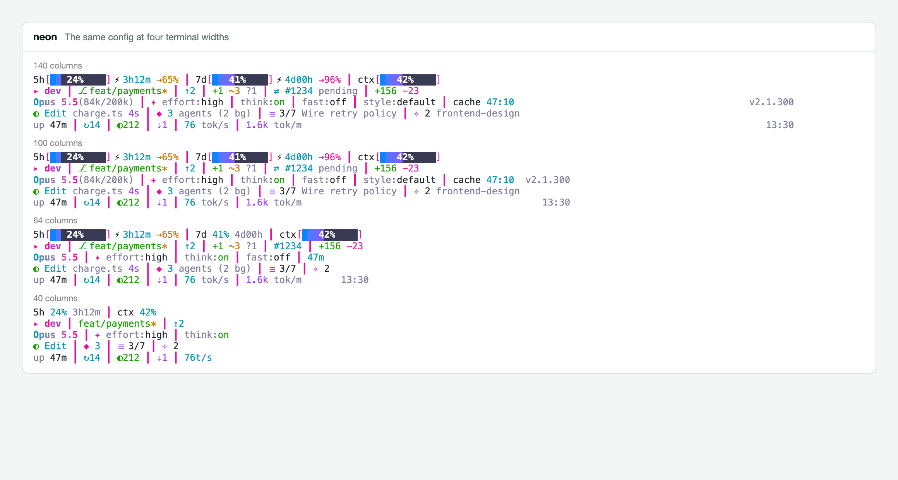

# claude-code-limit-bar

A neon status line for Claude Code. Rate limits, context, git, running tools, subagents
and session totals, in a bar you can rearrange from a live editor or a dotfile.



```sh
npx github:Abbishekk-DGS/claude-code-limit-bar install
```

That also gives you the short command `limit-bar`, used below. Your next session uses it. Needs Node 18 or newer and has no dependencies. Your existing
status line is saved, and `limit-bar uninstall` puts it back.

The background is transparent, so your terminal shows through, and the colours are picked
to read on both white and black. The bar calls you by your username. It never shows the folder, the repo or its own name
unless you turn those on, so nothing about the project you are in ends up in a screenshot.

## What it shows

Rows with nothing to show disappear. The defaults are:

1. **Limits.** 5-hour and 7-day gauges with the time to reset and where your pace is
   heading, the context gauge, and a warning when you will hit the limit before it resets.
2. **You and git.** Username, branch, ahead and behind, staged, modified, untracked and
   conflicted files, merge or rebase in progress, pull request, worktree, lines changed.
3. **The session.** Model and tokens, effort, thinking, fast mode, output style, prompt
   cache countdown, Claude Code version.
4. **Right now.** Running tool with its target and elapsed time, subagents including
   background ones, todos, skills.
5. **Totals.** Session length, turns, tool calls, compactions, output speed, token burn.

Another 40 or so can be turned on, such as stashes, tags, time since the last commit,
reset clock times, sparklines, cache hit rate and misses, MCP servers, and SSH or tmux
flags. `limit-bar modules` lists them all. Subagents also get neon rows in Claude Code's
agent panel, with their model, elapsed time, token trend and share of their context.

## Make it yours

**The live editor** shows the bar updating as you go:

```sh
limit-bar customize
```

Space turns a module on or off, the arrow keys change its row, `[` and `]` reorder it, and
`g`, `w`, `u` and `c` change the gauge design, gauge width, used or left, and the clock.

**The same from the command line:**

```sh
limit-bar show git_stash --row 2 --after git_changes
limit-bar hide version
limit-bar move clock --row 1
limit-bar set username neo
limit-bar set gauge_width 14
limit-bar set bar thin            # meter, thin, ticks or dots
limit-bar color pink "#ff00aa"
limit-bar reset                   # back to the defaults
```

These save to `~/.config/limit-bar/custom.toml`, so they never touch your own config.

**Or write it by hand.** Your own config lives in `~/.config/limit-bar/config.toml`.
`limit-bar init` writes a commented starter. Each step below is a complete, working change.

**Choose your rows.** A `">"` pushes what follows to the right.

```toml
[layout]
rows = [
  ["h5", "d7", "ctx"],
  ["user", "git", "git_changes", ">", "clock"],
]
```

**Recolour anything**

```toml
[palette]
cyan = "#7fe3dd"
pink = "#ff7a1a"
```

**Rewrite a built-in module.** They are all ordinary config, so
[`src/defaults.toml`](src/defaults.toml) doubles as a set of examples.

```toml
[module.ctx]
format = "context {ctx.pct | bar:20:dots} {ctx.tokens | tokens}"
style = "= ctx.pct > 80 ? 'hot bold' : 'muted'"
```

**Lay out a row in full.** Each `[[line]]` is a row with left, center and right sides.
Any `[[line]]` replaces `[layout]`.

```toml
[[line]]
left = ["model", "user", "git"]
right = ["ctx", "h5"]

[[line]]
if = "todo.total"
left = "{todo.done}/{todo.total} <muted>{todo.current}</>"
```

**Show anything a command can print.** Commands run in a background process, so a slow
one can't hold up the bar.

```toml
[source.kube]
command = "kubectl config current-context"
every = "30s"

[module.kube]
if = "source.kube.value"
format = "k8s {source.kube.value}"
style = "= contains(source.kube.value, 'prod') ? 'hot bold' : 'muted'"
```

**Let the bar react to what is happening.** A rule can override any part of the config.

```toml
[[when]]
name = "show the forecasts when a limit is close"
if = "ctx.pct >= 85 || limit.h5.pct >= 85"
[when.layout]
rows = [["h5", "d7", "ctx"], ["h5_forecast", "d7_forecast", "ctx_eta", "burn"]]
```

Rules can read the branch, project, model, terminal width, time of day, or the output of
any source. There are ready-to-copy configs in [`examples/`](examples): protecting `main`,
CI status, cloud context, and plain ASCII over SSH.

The [configuration reference](docs/CONFIG.md) covers every setting, all 19 filters, the
expression language and each variable. A test keeps it in step with the code.

## Built for small terminals

When a line doesn't fit, limit-bar gives things up gradually: modules switch to their short
format one at a time, then the least important ones leave, and text is only cut as a last
resort. You set the order with `priority`, and a rule can switch to a different layout at
any width.



## It tells you what it is doing

```sh
limit-bar validate    # mistakes, with line numbers and "did you mean"
limit-bar explain     # which files and rules applied, what is shown or hidden, and why
limit-bar fields      # every variable and its live value
limit-bar doctor      # checks the whole setup
```

```
config.toml:3  error  module.ctx.formt: unknown key "formt", did you mean "format"?
config.toml:5  warning  module.git.if: unknown variable "git.brnch", did you mean "git.branch"?
config.toml:7  error  line[0].left: unknown module "modle", did you mean "model"?
```

A broken config never takes the bar away. It keeps rendering what it can and shows the
problem on its own row.

## Forecasts

Beyond the numbers Claude Code provides, limit-bar works out:

- **Rate limit pace.** `limit.h5.projected` is where you will be at reset if your pace
  holds, and `limit.h5.hit_in` is how long until you hit 100%.
- **Time until context is full.** `ctx.eta` comes from your recent growth, and restarts
  after `/compact` instead of treating the drop as negative use.
- **History.** `history.ctx`, which `spark` turns into a sparkline.

The bar shows no dollar amounts. `cost`, `cost_rate` and `spend` modules exist if you add
them by hand, but they are not in the default rows or the editor.

These are straight-line estimates. Real usage comes in bursts, so treat them as a guide.
Projections stay off for the first 15% of a window, when there is too little to go on.

## Safety

A status line runs constantly, so it should be boring to trust.

- **No network access.** limit-bar makes no network calls and has no updater, telemetry or
  daemon. The only outside programs it starts are `git` and the commands you configure.
- **Projects can't run code.** A repo's `.limit-bar.toml` is ignored until you run
  `limit-bar trust`, which lists the commands it would run. Editing the file revokes approval.
- **Hostile text stays text.** Terminal control codes are stripped from branch names,
  session names and command output. Link addresses are limited to `http`, `https` and `file`.
- **Git stays read-only.** It runs with `core.fsmonitor`, external diff drivers and
  signature checks off, so a cloned repo's config can't use it to start a program.
- **No eval.** Expressions go through a small parser that can only read variables.

## Speed

About 50 ms per update as Claude Code runs it, nearly all of that Node starting up, and
under 1 ms for the render itself. Measured on an Apple Silicon MacBook with 8 GB of RAM;
run `limit-bar bench` for your own numbers. Claude Code waits for 300 ms of quiet between
updates, so this is well inside the budget. Git, history and transcript reads only happen
if your layout uses them, and the transcript is read incrementally, so long sessions cost
no more than short ones.

## Commands

| Command | What it does |
|---|---|
| `limit-bar install [--refresh SECONDS] [--no-agent-rows] [--dry-run]` | Set up Claude Code. Default refresh is 5 seconds |
| `limit-bar uninstall [--purge]` | Restore your previous status line |
| `limit-bar customize` | Live editor with a preview |
| `limit-bar modules [FILTER]` / `rows` | What you can show, and the current layout |
| `limit-bar show` / `hide` / `move NAME` | Change the rows |
| `limit-bar set [KEY VALUE]` / `color [NAME #HEX]` | Change settings and colours |
| `limit-bar reset` | Back to the defaults |
| `limit-bar preview [--state fresh\|working\|danger] [--cols N]` | Try it on sample data |
| `limit-bar init` | Write a commented starter config |
| `limit-bar validate` / `explain` / `fields` / `doctor` / `bench` | Inspect and debug |
| `limit-bar trust` / `untrust` | Approve or revoke this project's config |

## Limits

- It needs Node. A native binary would start faster, at the cost of a build per platform
  and an install that is harder to read.
- Windows is untested. CI runs on Linux and macOS.
- `tool.*`, `todo.*`, `agents.*` and `stats.*` read the session transcript, whose format
  is not a public contract. If it changes, they go empty rather than break.
- `todo.*` only sees the `TodoWrite` tool, so it stays empty in sessions that do not use it.
- `speed.output` reads low after subagents have run, because Claude Code's model time
  includes theirs while the session's token count does not.
- Status lines hide while Claude Code shows permission prompts and some menus. That comes
  from Claude Code itself.

## Credits

The design was informed by studying
[claude-code-usage-bar](https://github.com/leeguooooo/claude-code-usage-bar),
[ccstatusline](https://github.com/sirmalloc/ccstatusline) and
[claude-powerline](https://github.com/Owloops/claude-powerline), all MIT licensed and all
worth a look. limit-bar is a separate codebase and contains none of their code.

## License

[MIT](LICENSE)
